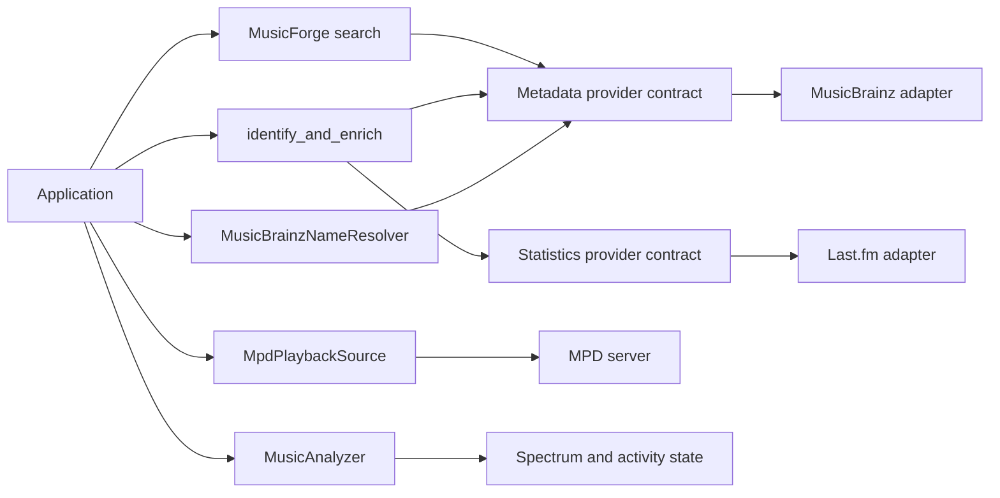

# libMusicForge architecture

libMusicForge exposes async metadata and playback APIs and an optional
synchronous PCM analyzer. Applications supply player observations or PCM and
own their own audio capture, UI and playback control.

| Entry point | Responsibility |
| --- | --- |
| `musicforge.MusicForge` | Search configured metadata providers and return typed recordings. |
| `musicforge.identification.identify_and_enrich` | Return MusicBrainz-style recording candidates and separately attributed artist/title statistics. Exposes provider failures alongside partial results. |
| `musicforge.analytics.compare_tracks` | Sort track statistics by listeners, scrobbles or their ratio. Undefined ratios remain missing. |
| `musicforge.playback` | Represent player observations and resolve candidate recordings with name and duration evidence. Durations are in milliseconds. |
| `musicforge.providers.mpd` | Read a track observation over MPD TCP. Idle playback or missing tags produce no observation. |
| `musicforge.analysis` | Analyze normalized mono PCM with a sample rate in Hz. Install the `analysis` extra for NumPy. |

Provider IDs are namespaced. Keep MusicBrainz recording IDs separate from
Last.fm artist/title statistics, and preserve metric provenance, units and
observation time. A candidate with matching credits, title and duration
still needs independent evidence to verify a recording match.

Use provider async context managers to close their owned HTTP clients.
Inject an HTTP client for provider tests and manage that client's lifetime
at the caller. The optional HTTP service and additional playback adapters
are roadmap items.

See the [README](../README.md) for installation and API snippets and the
[component tests](../component_test/README.md) for live checks.
